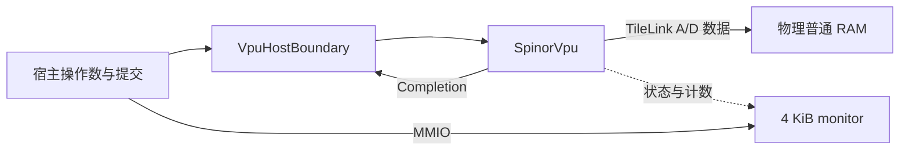

# 架构概览

Spinor 是以 RAM 为主要状态存储的向量协处理器。当前 VLEN128/ELEN64、单 lane、单指令在途，目标器件 `xczu15eg-ffvb1156-2-i`。构建与连接步骤见[接入指南](integration.md)。

M61提供可选`SpinorIsolated`外层：输入先寄存、四个总线方向寄存化，并通过preview/grant/done区分结果可用、发布授权和发布确认。隔离配置另启用LSU与整数操作数分级，旧直接配置RTL逐字节保持，详见[隔离指南](m61-isolation.md)。

## 状态与流水

32个架构向量寄存器各128位，总容量512字节。版本化寄存器文件保存已提交与候选版本；普通算术从已提交源读取、按字节更新候选目标。目的组在完成握手时发布版本，取消时保留原版本，避免用整组触发器快照复制向量状态。

RAM包含分布式存储资源，不能将“RAM优先”理解为所有状态都映射到BRAM。具体器件资源以对应生成输入的综合报告为准；上下文镜像大小也不代表物理存储副本的总量。

当前一次拥有一条指令，部分基础整数操作可重叠元素读取、执行和候选写回。共享乘除/浮点单元与不同指令家族具有不同延迟；指令之间没有当前公共顶层内的乱序、多发射或并行退休。较深预设调节整数分段位宽，不增加lane数。

## 运算与访存

数据通路包含整数/定点、掩码、置换、归约、FP32/64、最小FP16转换和Zvbb。具体支持集、非法几何及语义验收边界见[ISA覆盖表](isa-coverage.md)。

LSU复用向量状态端口，负责当前物理普通RAM访存。它按元素或字段提交前缀，不能像普通算术候选状态一样整体回滚。stop需排空总线并返回最终状态；分段、mask、whole和FOF有各自的恢复单位，见[访存协议](tilelink.md)。

monitor只观察状态和握手事件，不调度计算，不改变向量状态。context提供空闲时的VRF分块读写，由宿主保证独占和排空。

## 宿主职责

CPU保留取指/译码、源依赖、GPR/FPR写回、退休、VS/FS、特权、MMU/PMP和一致性管理。VPU提交边界检查一条不可撤销指令的身份和完成授权，不实现第二个CPU。

原生CPU可使用host FCSR配置，共享唯一架构FCSR，VPU仅锁存frm并返回逐指令flags。独立执行器默认使用standalone FCSR；不同宿主的作业队列和驱动需要另行实现。

## 资源与时序证据

直接顶层保留M56硬件基线，M60扩大了该配置的功能验证；M61新增寄存隔离顶层及可选内部流水级，资源与预算须区分配置。云端宿主配置的3.300ns为固定模型下的条件预算，排除DSP影响端点和真实器件布线/时钟，不能等同ZU15EG-2的300MHz实现通过。见[M61报告](../reports/m61/evaluation.md)和[验证与时序](validation.md)。

旧原型结构、周期记录和早期边界说明保存在[整理前架构文档](../archive/docs-m60/source/docs/architecture.md)，其未实现功能列表和下一步计划仅适用于当时版本。
